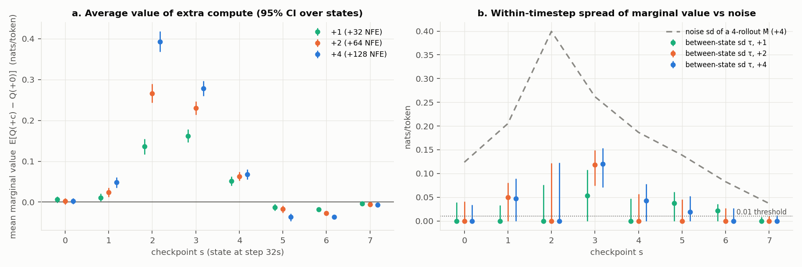
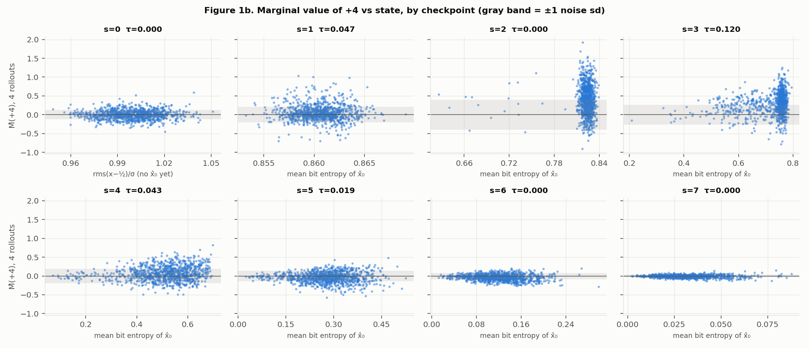
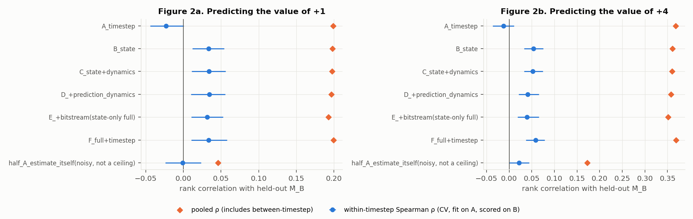
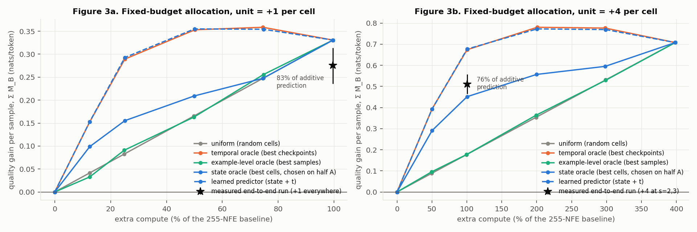
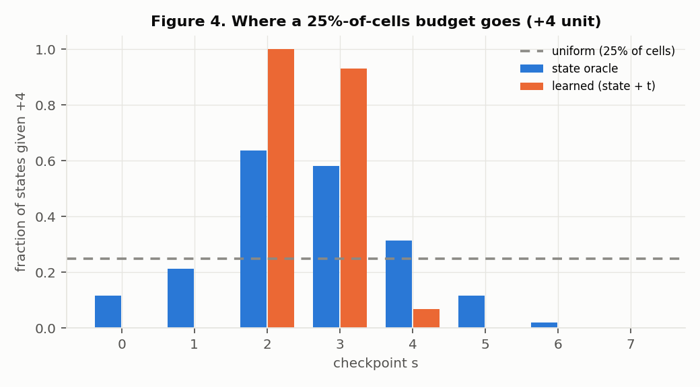

# Adaptive compute in CoBit-S: is there a state-dependent opportunity?

This reports the experiment in `experiments/adaptive_compute/PLAN.md` on CoBit-S, LM1B, with 1 RTX 4090. Phase 1 and phase 2 of Experiments 1–3 are complete, plus an end-to-end check of the oracle's assumption that gains add across checkpoints. Every number comes from a file under `experiments/adaptive_compute/results/`, with paths given relative to that folder. The lab notebook, including every decision and when it was made, is `../NOTEBOOK.md`.

## 1. Verdict

Against the plan's three success criteria (§20):

| Criterion | Result |
|---|---|
| **1. Opportunity:** marginal compute value varies between states at the same timestep | **Only at one of 8 checkpoints, and modestly.** At checkpoint 3 (steps 96–127) the between-state spread of the +4 gain is τ = 0.120 nats/token [0.071, 0.153], against a mean gain of 0.278. At the other seven checkpoints no between-state spread is detectable; the CIs include 0, with upper bounds of 0.01–0.12. The spread at checkpoint 3 survives adjustment for entropy changes (0.111). |
| **2. Predictability** from cheap state features | **Weak.** Within a timestep, cross-validated Spearman ρ between predicted and held-out marginal value is 0.03–0.06. The CI excludes 0, but it is far too low to steer allocation; the best single checkpoint is 3, at ρ ≈ 0.11–0.17. Pooled ρ (0.37 for +4) comes entirely from the timestep: timestep alone gives 0.368. |
| **3. Exploitability:** adaptive allocation beats the alternative at fixed compute | **Not for state-based allocation.** At every budget, the best state-aware policy matches the timestep-only schedule: −0.008 to +0.0035 nats/token, CIs including 0 or below it. Allocating by example is no better than uniform. A timestep-only schedule does beat uniform allocation by a wide margin, but every such gain comes with an entropy drop over the 0.02 flag. |

**By the plan's decision rule (§7, §19), this lands on the "timestep schedule may suffice" branch.** Formally the pre-registered test returned Case B, because checkpoint 3 shows real heterogeneity. But that heterogeneity is barely predictable and buys nothing over a timestep schedule. Per §20, the project should not move on to routing, MoE or token-level mechanisms.

What remains is a strong *temporal* effect. Extra self-conditioning refreshes help a lot in the windows starting at checkpoints 2–3 (steps 64–127, σ ≈ 1.71 → 0.82), a little at 4, and slightly *hurt* at 5–7. That effect is entangled with lower sample entropy, and it has to be separated from entropy reduction before it counts as a quality gain (§6).

## 2. Design (agreed before running; see NOTEBOOK.md 20:30 and 20:45)

- **States.** 1000 unconditional samples (LM1B CoBit-S has no prompts, so a "prompt" here is an initial-noise seed) from the production sampler: γ = 0.2, 254 Euler steps plus a final denoise, 255 NFE. Each is taken at 8 checkpoints, the starts of steps 0, 32, …, 224 (σ = 76.8, 3.39, 1.71, 1.12, 0.82, 0.62, 0.47, 0.34; `results/features.json` → `log_sigma`). The trajectory and saved states are the compute-allocation study's Run 1 (`runs/compute_allocation/batch0/states/`).
- **The compute unit "+c"** is c extra self-conditioning refreshes, x̂₀ ← D(x, σ_next, x̂₀), at every step of the 32-step window after the checkpoint, adding 32c model calls (+12.5% of baseline per unit). The σ grid, the update rule for x and the churn noise are all unchanged, and the state is refined at the same noise level. With c = 1 this is exactly the repo's `refined` self-conditioning mode (bit-identical in a unit test). Arms: +0, +1, +2, +4.
- **Quality** is Q = −(GPT-2-large NLL/token) of the final sample; higher is better.
- **Noise control.**
  - Q(x_t, c) is estimated from **4 rollouts per (state, arm)** with fresh churn noise after the checkpoint. All arms share each rollout's noise (common random numbers), so arm comparisons are paired.
  - Rollouts {0,1} form half A and rollouts {2,3} form half B. Each half gives an independent estimate of the marginal value, M̂_A and M̂_B. The between-state variance is then τ² = Cov(M̂_A, M̂_B), because rollout noise cancels out of that covariance.
  - The +0 arm doubles as the placebo: its own split-half covariance is ≈ 0 at every checkpoint (`analysis/heterogeneity.json` → `placebo_cov`).
  - Predictors and oracles are **fit or chosen on half A and scored on half B**. This avoids the winner's curse and regression to the mean, which made single-rollout differences meaningless (§9).
- **Cost** (`gpu_ledger.jsonl`): phase 1 (200 states) 0.641 GPU-h, phase 2 (800 more) 2.564, end-to-end checks 0.123. This study used **3.329 GPU-h**; the session total, including the compute-allocation study, is **4.350 of the 6 GPU-h cap**.
- **Validation.** 15 CPU unit tests pass (`experiments/compute_allocation/tests/`): `sc_refresh=1` everywhere equals `refined` mode, `sc_refresh=0` is a no-op, the NFE count is correct, and churn noise and the pre-window state are untouched. I also checked the split-half estimator on synthetic data with a known τ = 0.05; it recovered 0.052–0.059 with the placebo ≈ 0 (NOTEBOOK 20:50).

## 3. Experiment 1: heterogeneity (Figure 1)

`fig1_heterogeneity.png` and `fig1b_state_scatter.png` are drawn by `figs.py` from `analysis/heterogeneity.json` and `analysis/arrays.npz`. In the per-checkpoint panels of Figure 1b, the gray band is ±1 noise sd of a 4-rollout estimate.

All values below are for 1000 states, in nats/token, with 95% bootstrap CIs over states (from `analysis/heterogeneity.json`).

| checkpoint (σ) | mean M, +1 | mean M, +4 [CI] | τ for +4 [CI] | noise sd of M̂ (+4) | Δentropy (+4) | τ entropy-adjusted |
|---|---|---|---|---|---|---|
| 0 (76.8) | +0.006 | +0.002 [−0.005, +0.010] | 0.000 [0, 0.034] | 0.124 | −0.001 | 0.000 |
| 1 (3.39) | +0.011 | +0.048 [+0.036, +0.061] | 0.047 [0, 0.089] | 0.205 | −0.032 | 0.052 |
| 2 (1.71) | +0.136 | **+0.393** [+0.368, +0.418] | 0.000 [0, 0.123] | 0.399 | **−0.146** | 0.000 |
| 3 (1.12) | +0.162 | **+0.278** [+0.260, +0.297] | **0.120 [0.071, 0.153]** | 0.262 | −0.027 | 0.111 |
| 4 (0.82) | +0.052 | +0.068 [+0.056, +0.080] | 0.043 [0, 0.078] | 0.187 | +0.025 | 0.043 |
| 5 (0.62) | −0.013 | −0.037 [−0.046, −0.028] | 0.019 [0, 0.053] | 0.139 | +0.022 | 0.000 |
| 6 (0.47) | −0.018 | −0.036 [−0.041, −0.031] | 0.000 [0, 0.027] | 0.083 | +0.009 | 0.000 |
| 7 (0.34) | −0.004 | −0.007 [−0.009, −0.005] | 0.000 [0, 0.012] | 0.037 | +0.001 | 0.000 |

- **Pre-registered decision.** Case B requires a cell whose covariance CI excludes 0 *and* τ ≥ 0.01. Only `s3_c2` (τ 0.119 [0.075, 0.149]) and `s3_c4` (τ 0.120 [0.071, 0.153]) qualify. The three phase-1 hits were `s2_c4`, `s3_c2` and `s5_c1`. Of those, `s2_c4` and `s5_c1` did not replicate at 5× the sample size, which matches the roughly 1 false positive expected among 24 cells (NOTEBOOK 21:19).
- **Rollout noise swamps the real spread.** Even at checkpoint 3, the noise sd of a 4-rollout estimate (0.26) is twice τ, and the estimate's reliability is only 0.17–0.18 (`reliability_4`). Telling states apart there would take about 20 rollouts per state, far more than the extra compute is worth.
- **Most of the final quality is not yet fixed early on.** The between-state sd of Q(+0) is 0.00 at checkpoints 0–1, 0.02 at 2, 0.30 at 3, 0.42 at 4 and 0.49 at 7, against 0.50 for a single rollout (`Q0_between_state_sd`). The checkpoints where extra compute helps (2–3) are the ones where the outcome is still largely open.
- **Diminishing returns** (`marginal_steps`, per unit of 32 NFE):
  - Checkpoint 3: +0.162, then +0.068, then +0.024 per unit for the step from +2 to +4.
  - Checkpoint 2: almost linear up to +2 (+0.136, +0.129), then +0.064 per unit.
  - Checkpoint 4: +0.052, then about +0.01.
  - Efficiency η at +1 is 0.0051 nats/token per NFE at checkpoint 3 and 0.0043 at checkpoint 2.

## 4. Experiment 2: predicting the value of compute (Figure 2)

`fig2_predictors.png` is drawn from `analysis/predictors.json`. Each model is a ridge regression (λ = 1, standardised features), fit on M̂_A with 5-fold cross-validation over states and scored against M̂_B. The features are 15 cheap state and trajectory statistics plus log σ (NOTEBOOK 20:41). Hidden-state statistics were not collected.

- **Within-timestep ranking is barely above chance.** For +4, Spearman ρ is 0.054 [0.033, 0.075] (B, state statistics), 0.052 (C, + dynamics), 0.041 (D, + prediction dynamics), 0.039 (E, + bit-level features), and 0.058 [0.037, 0.078] (F, everything plus timestep). For +1 it is 0.03–0.034. The best single checkpoint is 3, with ρ = 0.17 (B) and 0.11 (F) for +4.
- **Timestep carries the predictive power.** Model A, timestep only, has pooled ρ = 0.368 for +4; adding state features doesn't improve on that (B 0.361, F 0.369). The most predictive single features are "fraction of token guesses changed in the last step" (ρ = 0.31 with M̂_A) and "fraction of uncertain tokens" (0.28). Both mostly track where a checkpoint sits in time.
- **State features don't transfer to new timesteps** (§9 ablation, `cross_timestep`). Training on 6 checkpoints and testing on the 2 held out, the state-only model gives pooled ρ = 0.115 and R² = −1.7; adding log σ gives 0.125 and −2.5. So compute demand is mainly a function of time, not an intrinsic, timestep-free property of the state.
- **Calibration** (slope of M̂_B on the prediction) is about 0.9–1.0 for every model except half A's own estimate, whose slope is 0.05–0.22. That is the winner's curse.
- **Predictor cost** is negligible: the features reuse the denoiser output from the previous step and take O(sequence) arithmetic, with no extra NFE.

## 5. Experiment 3: oracle allocation at fixed budget (Figures 3–4)

`fig3_oracle.png` and `fig4_allocation.png` are drawn from `analysis/oracle.json` and `analysis/additivity.json`. A budget gives a fraction (12.5%–100%) of the (state, checkpoint) cells one unit, either +1 (32 NFE) or +4 (128 NFE). Each policy chooses its cells on half A, and its gain is evaluated on half B. In the main oracle numbers, a sample's gains are summed across its checkpoints.

Per-sample gain in nats/token, for the +4 unit at a 25% budget (+100% compute). Δentropy is per sample.

| Policy | Gain | Minus uniform [CI] | Minus temporal oracle [CI] | Δentropy |
|---|---|---|---|---|
| uniform (random cells) | 0.177 | – | – | −0.036 |
| **temporal oracle** (checkpoints 2, 3) | **0.674** | +0.497 [0.464, 0.529] | 0 | −0.165 |
| example-level oracle | 0.177 | +0.000 [−0.029, 0.031] | −0.496 [−0.542, −0.454] | −0.034 |
| state oracle (best cells by M̂_A) | 0.451 | +0.274 [0.241, 0.307] | −0.222 [−0.257, −0.188] | −0.103 |
| learned predictor, state only (E) | 0.656 | +0.479 | −0.018 [−0.032, −0.004] | −0.159 |
| learned predictor, state + t (F) | 0.677 | +0.500 | **+0.003 [−0.005, +0.011]** | −0.164 |
| in-sample oracle (chosen and scored on B; optimistic) | 1.049 | +0.872 | +0.375 | −0.219 |

The same pattern holds at every budget and for both units (`oracle.json`). No state-aware policy beats the temporal oracle: the learned state + t predictor lands between −0.008 and +0.0035, with CIs including 0 or below it. Per-cell selection by noisy rollout estimates (the "state oracle") does worse than timestep alone. And the in-sample oracle shows how far a winner's-curse analysis would overstate the opportunity.

**Figure 4** shows where a 25% budget goes. The learned predictor spends nearly everything on checkpoints 2 and 3 (100% and 93% of those states) and almost nothing elsewhere, which is the temporal schedule. Local allocation to individual tokens or bits (plan §11-D) **was not tested**: the sampler has no way to apply compute to part of a sequence, and building one was out of scope for this measurement study.

**Additivity check** (`analysis/additivity.json`, `confirm/*.json`). This measures the full policies end to end on all 1024 samples, each paired with its Run 1 reference.

| Policy | NFE | Measured ΔQ [CI] | Additive prediction [CI] | Measured/predicted | GenPPL (ref 60.18) | Δentropy [CI] |
|---|---|---|---|---|---|---|
| +1 everywhere (= `refined` mode) | 509 | 0.276 [0.236, 0.314] | 0.332 [0.301, 0.365] | 83% | 45.81 | −0.069 [−0.086, −0.052] |
| +4 at checkpoints 2, 3 | 511 | 0.510 [0.464, 0.556] | 0.671 [0.642, 0.701] | 76% | 36.42 | −0.172 [−0.193, −0.150] |

Gains are **sub-additive** across checkpoints. Neither prediction falls inside its measured CI, so the oracle curves in Figure 3 overstate combined gains by roughly 20%. At equal NFE (about 510), concentrating the extra compute in checkpoints 2–3 gives 1.85× the gain of spreading it uniformly. It also lowers entropy 2.5× as much.

## 6. The entropy confound

Every large gain comes with lower unigram entropy:

- **Per checkpoint:** −0.146 at checkpoint 2, −0.027 at checkpoint 3 (+4).
- **End to end:** −0.069 and −0.172.
- **Per state:** the correlation between a state's marginal value and its entropy change is negative at every checkpoint and arm, from −0.17 (checkpoint 7) to −0.66 (`corr_M_dentropy`).

By the rule from the compute-allocation study (|Δentropy| > 0.02 means ΔNLL can't be read as quality on its own), every high-gain policy here is flagged. GenPPL 36.4 at entropy 4.14 is not comparable to 60.2 at 4.31.

The heterogeneity at checkpoint 3 does survive a linear entropy adjustment (τ 0.120 → 0.111). The *temporal* effect at checkpoint 2, though, is mostly a move along the GenPPL–entropy trade-off until shown otherwise.

## 7. What to do next

1. **Don't build state-dependent routing, MoE or token-level compute on this evidence.** Opportunity is modest and limited to one checkpoint, prediction is weak, and there is no exploitable gain over a timestep schedule.
2. **Test the temporal finding at matched entropy before adopting it.** The candidate is extra self-conditioning refreshes in steps 64–127, with none after step 160, where refreshes hurt. Two ways to test it:
   - Compare against the baseline sampler at a γ or temperature that gives the same entropy. In the compute-allocation study γ barely moved entropy, so another lever may be needed, such as S_noise or a decoding temperature.
   - Use a second metric that is less sensitive to entropy, such as MAUVE.
3. If the temporal effect survives, the natural mechanism is the plan's "adaptive scheduler" leaf: a fixed per-timestep compute schedule, with no state input.

## 8. Deviations from the plan

- **Prompts are initial-noise seeds**, because the model is unconditional. That gives 1000 states, the minimal-run size in §18.
- **The "+1" unit is one extra self-conditioning pass per step over a 32-step window** (+32 NFE), not a single model call. A single extra call out of 255 would be too small to measure. +8 was not run.
- **4 rollouts per (state, arm), a split-half noise floor, and evaluation on held-out halves** were added. These came out of the pre-run analysis showing that single-rollout ΔQ is mostly trajectory chaos, and were agreed with you before running.
- **Budgets are extra compute (+12.5% to +400%), not reduced compute** (the plan's 25–75% of baseline). The unit only adds compute.
- **Phase 3** (a separate expensive evaluation on a stratified subset) was not run, because every rollout was already scored with the final metric. The end-to-end runs in §5 serve as the confirmation.
- **Local (token/bit) allocation was not tested** (no mechanism exists; §5). Hidden-state features were not collected.
- **The oracle assumes gains add across checkpoints.** I tested this directly, and it does not hold exactly (§5).
- **Two analysis additions were made after seeing phase-2 data:** the paired "minus temporal oracle" CI, and the additivity table's prediction CIs. The thresholds and decision criteria were fixed earlier (NOTEBOOK 20:45 and 21:21).
- **Environment** is the same as the compute-allocation study: RTX 4090, bf16 autocast, eager denoiser, eager GPT-2 attention, no Slurm.

## 9. Limitations

- One model (CoBit-S on LM1B), one sampler setting (γ = 0.2) and one compute unit. Sub-stepping or extra churn could produce different heterogeneity.
- Quality is GPT-2-large NLL only, so the entropy confound is unresolved (§6).
- The upper CI bounds on τ at checkpoints 1, 2 and 4 (0.08–0.12) do not rule out moderate heterogeneity there. They do rule out heterogeneity large enough to be useful given how poorly it can be predicted.
- The features are cheap summaries of the state. A learned model reading the full state or hidden activations might predict better; that is the plan's "investigate richer trajectory signals" branch. Even at checkpoint 3 the exploitable headroom is bounded by τ ≈ 0.12 against a mean of 0.28.

## Files

- **Code:** `adaptive.py` (`rollouts`, `features`, `confirm`, `analyze`) and `analysis_ac.py`. The sampler option is `sc_refresh` in `diffusion/continuous/samplers.py`.
- **Results:**
  - rollout cells: `results/rollouts/s{s}_c{c}_k{k}.json`, giving per-row NLL, token count and entropy as [4 rollouts × 200 states];
  - features: `results/features.json`;
  - analyses: `results/analysis/*.json` and `arrays.npz`;
  - end-to-end runs: `results/confirm/*.json`;
  - GPU ledger: `results/gpu_ledger.jsonl`.
- **Large artefacts** (final tokens and bits per cell) are under `runs/adaptive_compute/` (gitignored).
- **Figures:** `report/*.png`, generated by `report/figs.py`.
