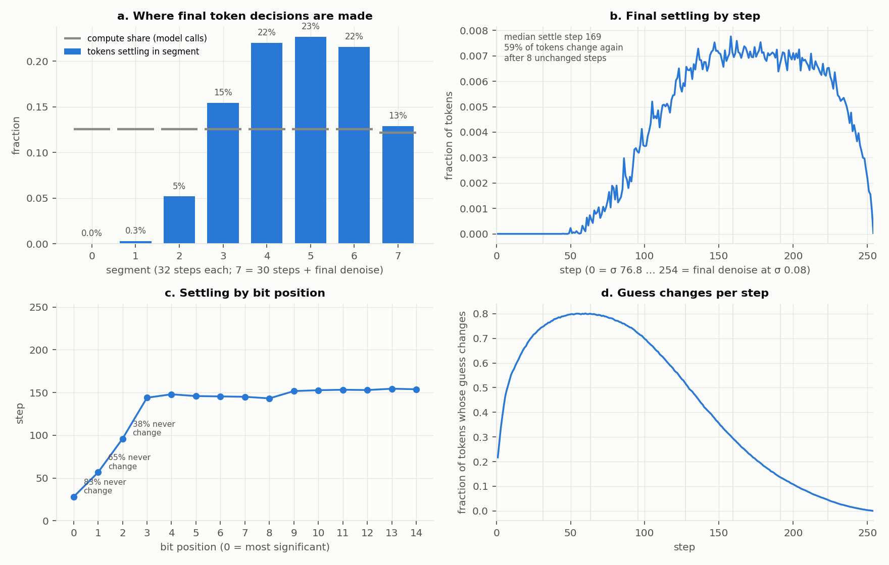
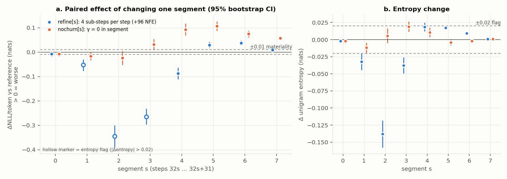
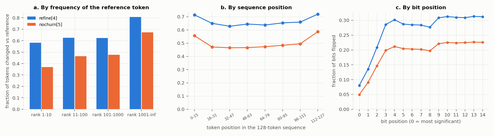

# Compute-allocation diagnostic: CoBit-S on LM1B at fixed NFE

Runs 1 and 2 of `experiments/compute_allocation/PLAN.md` are complete. **Run 3 stopped at its calibration pilot** because a stop condition was hit (§7 below). All numbers come from files this pipeline produced. Paths are relative to `experiments/compute_allocation/` unless they start with `runs/`, which is the gitignored large-artefact directory `runs/compute_allocation/`.

## 1. Summary verdict

Applying the §8 table segment by segment, the bottleneck sits in the second half of the trajectory, and the main cause is **uncorrected errors**:

- **Segments 5, 6 and 7 (steps 160–253 plus the final denoise): uncorrected errors.** Removing churn there costs ΔNLL/token +0.107 [0.088, 0.126], +0.075 [0.061, 0.088] and +0.058 [0.050, 0.065]. Making the steps 4× finer there does not help: it materially *hurts* in segments 5 and 6 (+0.029 [0.017, 0.042] and +0.038 [0.028, 0.048]).
- **Segment 4 (steps 128–159): both causes, of equal size.** `refine[4]` gives −0.087 [−0.111, −0.063] and `nochurn[4]` gives +0.093 [0.069, 0.117], neither entropy-flagged.
- **Segments 0–3: no bottleneck that §8 can classify.** Refining segments 1–3 cuts NLL by a lot (−0.052, −0.345 and −0.265 nats/token; GenPPL 60.2 → 42.6 at segment 2). Every one of those branches also lowers entropy by more than 0.02 (−0.032, −0.138, −0.038), so by the pre-registered §7 rule their ΔNLL cannot be read as a quality gain on its own.

The "model" row does not apply.

This only partly matches where Run 1 sees decisions being made. Final token decisions concentrate in segments 4–6 (22.0%, 22.7% and 21.6% of tokens, against 12.5% of compute each). Almost nothing settles in segments 0–1 (0.0% and 0.3%).

The fixed-NFE confirmation (Run 3, uncorrected-errors variant, s\* = 5) could not be run as designed, because on this model γ does not move entropy measurably. In the single-seed pilot, raising γ 1.75× in segment 5 gave ΔNLL −0.018 [−0.037, +0.001] with Δentropy −0.011, which is **not material**. So far there is no evidence that reallocating churn into segment 5 improves quality at fixed NFE.

## 2. Setup

| Item | Value |
|---|---|
| Code | branch `compute-allocation-diagnostic`. Sampler hooks are in `2f5661d`; driver and analysis in `ba06fad`, `5f8db4c` and later commits. Run 1 and Run 2 batch 0 outputs record `2f5661d` because the driver was still uncommitted when they ran. Its generation path was unchanged afterwards; the only later edits were the scorer fallback (made before Run 1), the step-log entropy clamp, and the new subcommands. |
| Config | `configs/lm1b/continuous/eval/rate_eval_seeds.py`, γ = 0.200 spec (`s_churn = 51`, tag `ddim_entropic_scr-carry_tnfe-256_anfe-256_steps-255_gs0.0_term-1.10_stoch-ch51-n1.003-q0_1`) |
| Sampler as actually executed | Entropic grid with **255 σ points, σ 76.756 → 0.08** (the table maximum and the terminal σ). That is **254 Euler steps plus the final denoise, 255 model calls per sample**, confirmed by counting calls (`results/identity_check.json`). Per-step γ = 51/254 = 0.200787 on all 254 steps; S_noise = 1.003; self-conditioning `carry`; `ati_eta = 0` |
| Precision | bf16 autocast for the denoiser (as production's `external_ppl` path hard-codes) plus TF32; state x kept in fp32; **eager (no `torch.compile`)** |
| Samples | 1024 per cell, two chunks of 512 with production's chunk seeds (seed 42, or 43 for batch 1). Churn noise per step is seeded by (chunk seed, step) |
| Scoring | `openai-community/gpt2-large`, bf16, **eager attention**, one text at a time, full decoded text; entropy = mean per-sample unigram entropy of the 128 BERT ids |
| Checkpoint | `cobit_s_lm1b_1M_ema.pt` from `gbatzolis/CoBit` (snapshot `2f2979d7`), 533,878,820 bytes, **SHA-256 `82094e59d5894c2cc468f0928fe427916c55af0059a44f175a91fe9aa6628b61`** (matches the Hub LFS hash) |
| Hardware | 1× NVIDIA GeForce RTX 4090 (24 GB), driver 575.57.08, host `csic46` (x86_64, no Slurm). Every result is from this one GPU |
| Software | Python 3.9.18, torch 2.0.1+cu118, transformers 4.38.1, flash-attn 2.2.2, numpy 1.24.1, scipy 1.13.1, matplotlib 3.9.4 (conda env `sedd`) |
| Jobs | Background processes started by `run_job.sh` (no Slurm). Logs in `logs/<job>.log`. PIDs: identity check 63404, Run 1 70874, Run 2 76261, batch-1 reference 136740. The batch-1 probes, Run 3 pilot and step-log rerun PIDs are in their log headers and in `NOTEBOOK.md` |
| Cost | `results/gpu_ledger.jsonl`: **1.021 GPU-hours in total** (cap: 6). One full 1024-sample cell is about 104 s generation + 12 s scoring ≈ **0.033 GPU-h**. By stage: identity check 0.044, Run 1 0.033, Run 2 batch 0 (17 branches) 0.428, batch 1 (reference + 8 branches) 0.256, Run 3 pilot (7 cells) 0.231, step-log rerun 0.030. Under 2 min of failed launches are unlogged |

**Correctness checks that all passed:**

- **Bit-identity with `main`.** With no new options, the modified sampler matches `main`'s sampler bit for bit on one production chunk (max |Δp| = 0), and a rerun is identical (`results/identity_check.json`).
- **CPU unit tests.** 12 pass (`tests/test_sampler_diagnostic.py`): the §10 four, plus σ placement of the sub-steps, NFE count, nochurn scope, and "branch from saved state = same override from step 0".
- **Null replay.** `null` is bit-identical to the reference in both batches (`results/batch{0,1}/null.json`).
- **Reference rerun.** Rerunning the reference trajectory reproduces it exactly (`results/batch0/step_logs_rerun.json`).

## 3. Anchor (Run 1)

| | GenPPL | Entropy | Source |
|---|---|---|---|
| Run 1 (seed 42) | **60.176** | **4.3129** | `results/batch0/reference.json` |
| Batch 1 reference (seed 43) | 59.924 | 4.3102 | `results/batch1/reference.json` |
| README, single seed | ≈ 59–60 | ≈ 4.31 | README |
| Paper (10 seeds) | 59.76 ± 0.57 | 4.31 | README Table 1 |

The pre-set gate (GenPPL in [58.5, 60.5] and |entropy − 4.31| ≤ 0.015) **passes** (`results/analysis/run2_analysis.json` → `anchor`). Run 1 sits 0.18 above the README's literal "59–60" and 0.42 above the paper mean, within one seed s.d. The setup here differs from production (4090, eager denoiser, eager GPT-2 attention, older libraries), but that does not show up beyond seed noise.

## 4. Where decisions are made (Run 1 settling, §13.1)

`settling.png` is drawn from `results/analysis/run1_settling.json` by `fig_settling.py`. A token's guess is the argmax bits of D at each step, and its settling step is the last step at which that guess changes.

- **Final decisions are made late.** By segment 0–7, the share of tokens settling is **0.0%, 0.3%, 5.2%, 15.4%, 22.0%, 22.7%, 21.6% and 12.9%**. The uniform entropic grid gives each segment 12.5% of compute (12.2% for segment 7). The median settling step is 169 of 254.
- **Early guesses are mostly noise.** Up to 80% of guesses change at every step around step 55 (panel d). Every token provisionally settled in segment 0 changes again later; for segment 1 the figure is 86%.
- **Revisions are common in the middle.** 59% of all tokens change again after having been unchanged for 8 steps. That share is about 53–56% for tokens first settling in segments 2–5, 43% in segment 6 and 16% in segment 7.
- **By bit position**, the three most significant bits rarely change (83%, 65% and 38% never change), because BERT ids are below 30,522 < 2¹⁵. Bits 3–14 all settle around steps 143–154; there is no MSB→LSB ordering beyond that.
- The per-step mean bit entropy of D falls from 0.87 bits at step 0 to 0.007 by step 240, and the churn noise shrinks with σ (σ-increment 51.0 at step 0, 0.10 at step 253).

This is descriptive. On its face, segments 0–2 receive 37.5% of compute while making about 5.5% of final decisions.

## 5. Per-segment results (Run 2, §13.2)

ΔNLL/token is the ratio-of-sums change in log GenPPL; > 0 means worse. CIs are 95% paired bootstrap (10,000 resamples). "Batches 0+1" means the pooled 2048 paired samples, used where batch 0 was borderline. Tokens changed is the fraction of token ids that differ from the reference; the null floor is 0.000 exactly, so net equals gross. All source rows are in `results/analysis/run2_table.csv` and `results/analysis/run2_analysis.json`.

| s | branch | extra NFE | ΔNLL/token [95% CI] | GenPPL ref → branch | Δentropy | flag | tokens changed | material | batches |
|---|---|---|---|---|---|---|---|---|---|
| 0 | refine | +96 | −0.0075 [−0.0179, +0.0029] | 60.05 → 59.60 | −0.0020 | | 0.289 | no (borderline) | 0+1 |
| 1 | refine | +96 | −0.0523 [−0.0768, −0.0294] | 60.18 → 57.11 | −0.0322 | **flag** | 0.383 | yes, flagged | 0 |
| 2 | refine | +96 | −0.3452 [−0.3911, −0.3007] | 60.18 → 42.61 | −0.1379 | **flag** | 0.902 | yes, flagged | 0 |
| 3 | refine | +96 | −0.2648 [−0.2971, −0.2324] | 60.18 → 46.18 | −0.0377 | **flag** | 0.868 | yes, flagged | 0 |
| 4 | refine | +96 | **−0.0875 [−0.1112, −0.0632]** | 60.18 → 55.14 | +0.0185 | | 0.663 | **yes** | 0 |
| 5 | refine | +96 | +0.0295 [+0.0172, +0.0415] | 60.05 → 61.85 | +0.0174 | | 0.400 | yes (worse) | 0+1 |
| 6 | refine | +96 | +0.0379 [+0.0276, +0.0484] | 60.18 → 62.50 | +0.0093 | | 0.174 | yes (worse) | 0 |
| 7 | refine | +90 | +0.0094 [+0.0063, +0.0124] | 60.05 → 60.61 | +0.0008 | | 0.030 | no (borderline) | 0+1 |
| 0 | nochurn | 0 | −0.0070 [−0.0178, +0.0037] | 60.05 → 59.63 | −0.0022 | | 0.292 | no (borderline) | 0+1 |
| 1 | nochurn | 0 | −0.0163 [−0.0335, +0.0005] | 60.05 → 59.08 | −0.0118 | | 0.444 | no (borderline) | 0+1 |
| 2 | nochurn | 0 | −0.0237 [−0.0517, +0.0044] | 60.05 → 58.64 | +0.0057 | | 0.897 | no (borderline) | 0+1 |
| 3 | nochurn | 0 | +0.0315 [+0.0087, +0.0544] | 60.05 → 61.97 | +0.0191 | | 0.901 | yes (borderline) | 0+1 |
| 4 | nochurn | 0 | **+0.0930 [+0.0686, +0.1175]** | 60.18 → 66.04 | +0.0106 | | 0.725 | **yes** | 0 |
| 5 | nochurn | 0 | **+0.1070 [+0.0879, +0.1262]** | 60.18 → 66.97 | −0.0040 | | 0.500 | **yes** | 0 |
| 6 | nochurn | 0 | **+0.0745 [+0.0612, +0.0878]** | 60.18 → 64.83 | −0.0020 | | 0.285 | **yes** | 0 |
| 7 | nochurn | 0 | **+0.0577 [+0.0499, +0.0653]** | 60.18 → 63.75 | +0.0008 | | 0.102 | **yes** | 0 |
| – | null | 0 | 0 (exact) | 60.05 → 60.05 | 0 | | 0.000 | – | 0+1 |

`segment_effects.png` is drawn by `fig_segments.py`; hollow markers are entropy-flagged branches.

**How §8 applies, per segment** (`run2_analysis.json` → `decision`). Here R(s) means `refine[s]` is a material, unflagged improvement. N(s) means `nochurn[s]` is material, unflagged, and at least 0.01 above the median `nochurn` effect (0.0446).

| Segment | Outcome | §8 row |
|---|---|---|
| 4 | R and N | both |
| 5, 6, 7 | N only (refine is not an improvement there) | uncorrected errors |
| 0–3 | neither | none |
| 1–3 | `refine` effects material but flagged | not interpretable on their own |

The last §8 row, "the pattern doesn't match where decisions are made", partly applies. Segments 6 and 7 fall outside the two segments with the most settling (5 and 4), though segment 6 is within 1.1 points of segment 5.

**Still borderline after the single extra batch §7 allows:** `refine[0]`, `refine[7]` and `nochurn[0..3]`. They are reported as unresolved, and none of them affects the classification above.

**Two patterns outside the §8 table:**

- **Refining late hurts.** Finer steps in segments 5–6 materially worsen GenPPL. One plausible reading: with churn applied once per original step, coarse Euler steps in this region help correct errors, and splitting them removes some of that effect. This was not tested.
- **The early refine gains are entangled with entropy.** In segments 1–3 the gains always come with lower entropy, by up to −0.138 nats in segment 2, which is about seven times the flag threshold.

## 6. Concentration and token-level findings (§13.4)

All values below are from `run2_analysis.json` (`rows.*.top10_share_*`, `token_breakdowns_batch0`).

- **Effects are spread across samples, not carried by a few.** For every material branch, the top 10% of samples carry 27–30% of total |ΔNLL| (`refine[1]` 40%). For reference, if per-sample changes were normally distributed, the top 10% would carry 25.8% of the total |change|; this is an analytic value, not a measurement. In 92–98% of samples the NLL changes at all, and almost every sample has at least one changed token. The signed top-10% share exceeds 1 when the net effect is small and per-sample effects cancel (for example `refine[0]` at 6.2).
- **Rare tokens change most.** For `refine[4]`, 81% of tokens with reference-corpus rank above 1000 change, against 58% of the top-10 tokens. For `nochurn[5]` the figures are 67% against 37%. Special tokens ([PAD]/[CLS]/[SEP] etc.) are much more stable under late-segment branches: `nochurn[5]` changes 17% of them against 51% of regular tokens, and `nochurn[7]` 0.1% against 10.4%.
- **Position:** sequence edges change slightly more. The first and last 16 positions change about 6–9 points more than the middle (`refine[4]`: 0.71 and 0.72 against 0.63–0.66).
- **Bit position:** the three most significant bits flip least, constrained by the vocabulary range. Bits 3–14 flip at an almost flat rate, slightly higher for bits 9–14.

`token_breakdown.png` is drawn by `fig_tokens.py` and compares `refine[4]` with `nochurn[5]`.

## 7. Run 3: stopped at calibration (stop condition)

The rule (fixed before batch 1, see deviations) selects the **uncorrected-errors variant with s\* = 5**. The modified condition uses γ_in = 1.75·γ inside segment 5 and γ_out = c·γ elsewhere, with c to be calibrated so that entropy matches the baseline.

**Pilot** (base γ = 0.2, seed 42, paired with Run 1; `results/analysis/run3_pilot.json`):

| c | GenPPL | entropy | Δentropy vs Run 1 [CI] | ΔNLL/token [CI] |
|---|---|---|---|---|
| 0.5 | 58.869 | 4.3061 | −0.0068 [−0.0219, +0.0087] | −0.0220 [−0.0602, +0.0166] |
| 0.8 | 58.872 | 4.3040 | −0.0089 [−0.0199, +0.0020] | −0.0219 [−0.0534, +0.0112] |
| 0.9 | 58.832 | 4.3043 | −0.0086 [−0.0175, +0.0005] | −0.0226 [−0.0513, +0.0068] |
| 1.0 | 59.103 | 4.3023 | −0.0106 [−0.0152, −0.0059] | −0.0180 [−0.0373, +0.0008] |
| 1.3 | 63.327 | 4.3076 | −0.0053 [−0.0174, +0.0068] | +0.0510 [+0.0187, +0.0837] |

Uniform-γ baseline at seed 42: γ 0.185 → 59.554 / 4.3115; γ 0.200 → 60.176 / 4.3129; γ 0.215 → 58.808 / 4.3004 (GenPPL / entropy).

**Why the design can't be run as specified:**

1. **Entropy can't be matched.** Raising γ in segment 5 *lowers* entropy slightly, and no c in [0.5, 1.3] restores it: the response is non-monotone and within paired noise.
2. **γ doesn't bracket entropy.** Across the planned γ range of 0.185–0.215, entropy moves by at most 0.013 and non-monotonically, about the size of seed-to-seed noise (4.3129 vs 4.3102 at γ = 0.2). "GenPPL interpolated to entropy 4.31" from three such points would be a ratio of noise to noise.

So no main Run 3 cells were run. **The pilot is not a Run 3 result.** It is one seed, and its only material effect is that c = 1.3 is worse.

**Proposed alternatives (your call):**

- **(A) Fixed-γ paired test.** Compare at base γ = 0.2 over 3 seeds, paired, and use the §7 entropy flag in place of interpolation. The pilot's Δentropy (−0.011) is under the flag. Cost ≈ 6 cells ≈ 0.2 GPU-h.
- **(B) Wider γ grid.** Use, for example, {0.10, 0.20, 0.30} so entropy actually moves, then interpolate. 18 cells ≈ 0.6 GPU-h, with a risk of strong GenPPL curvature.
- **(C) Step-size test instead.** Run the step-size variant on segments 1–3, where the large but entropy-confounded gains are. It would also need entropy control, for example through (A)'s flag rule.

## 8. Deviations from the plan

1. **Hardware and scheduler.** One RTX 4090 on a workstation, not GH200s on Isambard, and background processes instead of Slurm. Agreed with you at the start. Not pooled with GH200 numbers.
2. **254 Euler steps, not 255** (repo behaviour; NFE accounting reports 256). Segment 7 therefore has 30 steps plus the final denoise, and `refine[7]` adds +90 NFE, not +96.
3. **σ range 76.756 → 0.08**, not 80 → 0.002 (table maximum and terminal σ); per-step γ = 0.200787.
4. **Precision is bf16 autocast plus TF32 (production), not fp32 plus TF32** as §4 says.
5. **No `torch.compile`.** Inductor/Triton crashes with "misaligned address" in this env, so the denoiser runs eagerly.
6. **GPT-2-large uses eager attention, not SDPA.** transformers 4.38 lacks GPT-2 SDPA support, and I did not upgrade packages in the shared env. Every branch uses the same scorer.
7. **Older libraries than the README** (torch 2.0.1, transformers 4.38). pytest, scipy and matplotlib were added to `sedd`; torch was untouched.
8. **Churn noise is seeded per step** by (chunk seed, step) in every diagnostic run, as §10 requires. Run 1 therefore uses different churn draws from production; its initial noise is identical to production's.
9. **No LM1B data downloaded.** It isn't needed with conditioning off. Token-frequency ranks come from the Run 1 reference corpus, and the real-data reference GenPPL was not computed.
10. **Analysis definitions** not given in the plan (ΔNLL as ratio of sums, anchor-gate tolerances, "much more"/"spread evenly", settling definitions) were fixed in `NOTEBOOK.md` at 17:27, before any Run 1 or Run 2 data existed.
11. **Two decision-logic items were written after seeing batch-0 Run 2 data but before batch 1.** (a) A fix so §8 is applied per segment; the first version returned only the first matching row globally. (b) The rule choosing the single Run 3 variant when segments fall in different rows: the cause covering more segments wins, and s\* is the segment with the largest effect. Thresholds were not changed.
12. **Six branches remain borderline** after the one extra batch §7 permits; no further batches were run.
13. **A bug in the per-step bit-entropy log** (NaN, from an fp32 clamp) was fixed, and the step logs were regenerated by an exact rerun.
14. **A mis-specified batch-1 launch** was killed after about 20 s, before anything was written.
15. **Run 3 stopped at calibration** (§7 above).

## 9. Limitations and suggested follow-ups

- **Entropy confound.** The largest effects in the study, `refine[1..3]`, are not interpretable under the plan's own entropy rule. The model's entropy is almost insensitive to γ, so the matched-entropy framing of §7 and §9 needs a different entropy control. Resolving whether finer steps early are a real quality gain is the most valuable next step.
- **Unexplained late-refine harm.** Refining segments 5–6 makes samples worse. A useful check is `refine` with churn re-applied at every sub-step, or with churn scaled to the sub-step size.
- **Small samples.** One batch of 1024 per branch (two for borderline branches); six branches remain borderline. The `nochurn` "much more" criterion uses the median of the eight segments and is sensitive to that choice.
- **Single GPU and stack.** One GPU type, bf16, an eager denoiser and eager GPT-2 attention. The anchor agrees with the README within seed noise, but absolute GenPPL values shouldn't be compared with GH200 runs.
- **Settling is measured on argmax guesses** of D at each step. It describes where decisions are made, not why. The provisional-settling window (8 steps) is arbitrary.
- **Run 3 has not been run.** Option (A) in §7 is the cheapest way to get a fixed-NFE answer for s\* = 5; the pilot suggests the effect will be small.

## Files

- **Driver:** `diagnose.py` (`reference`, `probe`, `identity-check`, `run3`, `analyze`).
- **Analysis:** `analysis.py`.
- **Tests:** `tests/test_sampler_diagnostic.py`.
- **Lab notebook:** `NOTEBOOK.md`.
- **Per-branch scores:** `results/batch{0,1}/*.json`. These hold per-sample NLL, token counts and entropy, plus metadata.
- **Run 3 pilot:** `results/run3/*.json`.
- **Analysis outputs:** `results/analysis/*.json` and `*.csv`.
- **Large artefacts:** under `runs/compute_allocation/`. These are the bits, tokens and texts per branch, the boundary states, and `step_logs.pt`.
- **Figures:** `report/*.png`, each regenerated by the matching `report/fig_*.py`.
